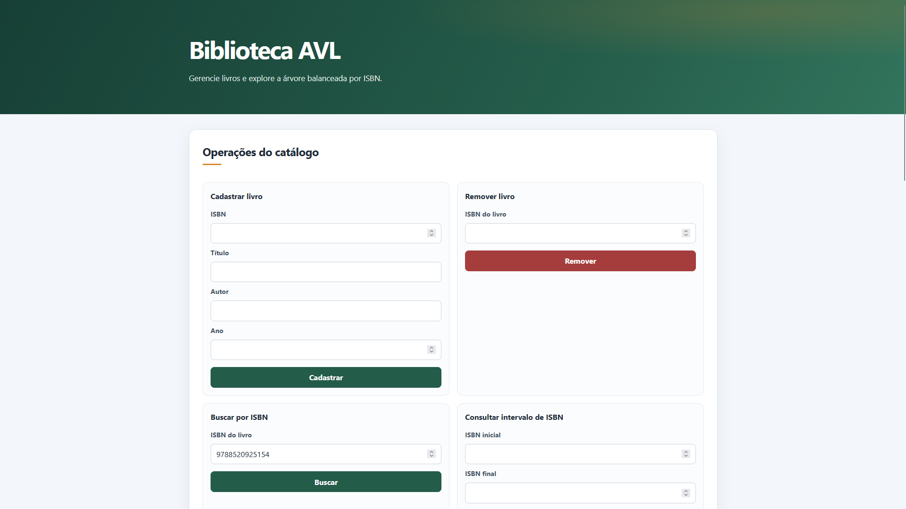

# G11_Arvores_EDA2-2026.2

**Conteúdo da Disciplina**: Árvores (AVL)
**Grupo**: G11 — Isaac Lucas e Breno Alexandre

## Sobre

A **Biblioteca AVL** é uma aplicação web que gerencia um acervo de livros usando uma árvore AVL
indexada por ISBN. Dá para cadastrar, buscar e remover livros, listar o catálogo em ordem
alfabética, consultar um intervalo de ISBN e ver a árvore sendo redesenhada a cada operação —
com as rotações destacadas.

Tudo roda no navegador, sem backend e sem dependências.

## Screenshot



## Site

Acesse [aqui](https://eda2-2026.github.io/G11_Arvores_EDA2-2026.2/).

## Vídeo

Assista à apresentação [aqui](https://youtu.be/xWagYmGd2Us).

## Funcionalidades

- Cadastro de livros (ISBN, título, autor e ano);
- Remoção por ISBN, com rebalanceamento da árvore;
- Busca por ISBN, destacando o caminho percorrido;
- Catálogo em ordem alfabética de título;
- Consulta por intervalo de ISBN;
- Visualização da árvore em SVG, com destaque da última rotação (LL, RR, LR ou RL);
- Métricas na tela: nós, altura e total de rotações.

## Como executar

**Linguagem**: `JavaScript`<br>
**Framework**: `Nenhum (HTML5 puro)`<br>
**Dependências**: Nenhuma (Node.js 20+ apenas para os testes)

1. Abra o `index.html` no navegador ou sirva por HTTP:
   ```bash
   python -m http.server 8000
   ```
   e acesse `http://localhost:8000`.
2. Testes automatizados:
   ```bash
   npm test
   ```

## A árvore AVL

A árvore é indexada pelo **ISBN** (numérico). Cada nó guarda o livro e a altura; o fator de
balanceamento é `altura(esquerda) - altura(direita)` e precisa ficar entre -1 e 1. Quando uma
inserção ou remoção desbalanceia, a árvore aplica uma das quatro rotações:

| Caso | Quando acontece |
|---|---|
| LL | desbalanceamento à esquerda do filho esquerdo |
| RR | desbalanceamento à direita do filho direito |
| LR | esquerda no filho esquerdo, depois direita |
| RL | direita no filho direito, depois esquerda |

Com isso, busca, inserção e remoção ficam **O(log n)** no pior caso. A listagem em ordem
alfabética é uma visão da interface: os livros vêm do percurso em-ordem (por ISBN) e são
ordenados por título com `localeCompare("pt-BR")`.

## Estrutura

```text
.
├── README.md
├── index.html
├── package.json
├── .gitignore
├── assets/
│   └── print.png
├── css/
│   └── style.css
├── js/
│   ├── avl.js             # árvore AVL (inserir, remover, buscar, intervalo, snapshot)
│   ├── livro.js           # modelo de livro
│   ├── acervo.js          # catálogo em memória + livros de exemplo
│   ├── visualizacao.js    # desenho da árvore em SVG
│   └── app.js             # eventos e atualização da interface
├── tests/
│   ├── avl.test.js
│   ├── interface.test.js
│   └── helpers/
│       └── fake-dom.js
└── .github/
    └── workflows/
        └── tests.yml
```

## Testes

```bash
npm test
```

Os testes do núcleo cobrem as invariantes da AVL (fator de balanceamento em todos os nós), as
quatro rotações, inserção e remoção (folha, um filho, dois filhos e raiz), busca, intervalo de
ISBN e um teste aleatório com seed fixa comparando com um array ordenado.

## Observações

- Os dados ficam em memória: recarregar a página restaura o acervo de exemplo.
- Sem Rubro-Negra, sem comparação entre árvores e sem benchmark nesta entrega.
